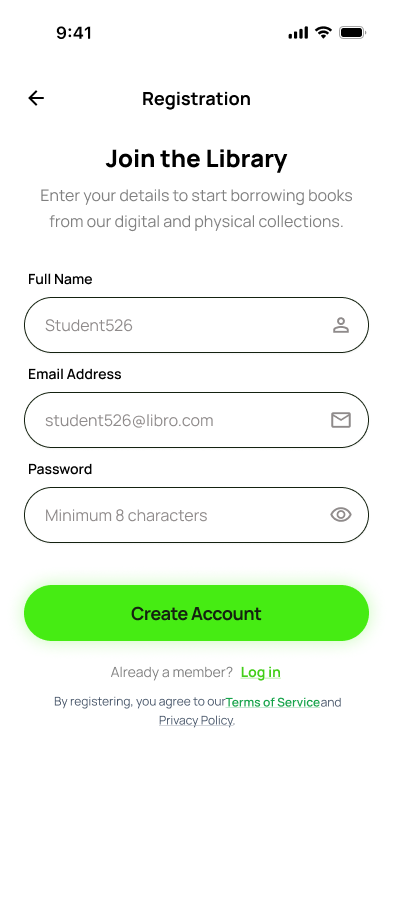

# 📚 Libro – Library Borrowing & Return System

### A Mobile App UI/UX Design | Figma

## 📖 About the Project

Libro is a mobile application UI/UX design created to make library book borrowing and returning simple and convenient. The design focuses on a clean interface and a smooth user experience.

## ✨ Key Features

- User Registration and Login
- Forgot and Reset Password
- Member Dashboard
- Browse and Search Books
- Book Borrowing
- QR Code Confirmation
- Borrowing History
- Book Return Management

## 🛠️ Tools Used

- Figma
- UI/UX Design
- Wireframing
- Prototyping

## 🎨 Design Screens

The project includes:

- Splash Screen
- Login and Registration
- Member Dashboard
- Book Browsing and Search
- Borrow Confirmation
- Borrowing History
- Return Process
- Success and Confirmation Screens

## 🎯 Project Goal

To create a user-friendly mobile library experience that simplifies book discovery, borrowing, and returning.

## 📱 App Screenshots

Here are the key screens of the Libro mobile application UI/UX design.

### 1. Splash Screen

### 2. Registration

### 3. Member Login

### 4. Member Dashboard

### 5. Browse & Search Books

### 6. Search Book

### 7. Borrowed Book Details

### 8. Borrow Confirmation

### 9. Borrow Successful

### 10. Borrow History

### 11. Request Extension

### 12. Extension Confirmed

### 13. Return Success

### 14. Forget Password

### 15. Password Reset Successful

### 16. Registration Successful

### 17. QR Code Coming Soon

## 🎨 Figma Design

[View Libro UI/UX Design on Figma](https://www.figma.com/design/S0PhSmlX7iCbB9c6lZ0McW/Libro-%E2%80%93-Library-Borrowing---Return-System?node-id=0-1&t=TdkSlVzPuAIQD6FO-1)

## 👩‍💻 Designed By

Sanjna Rajwani
